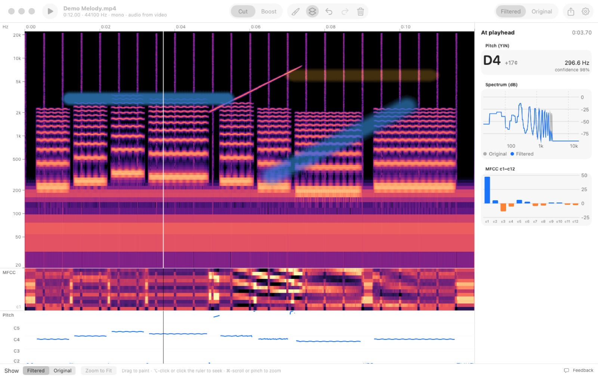
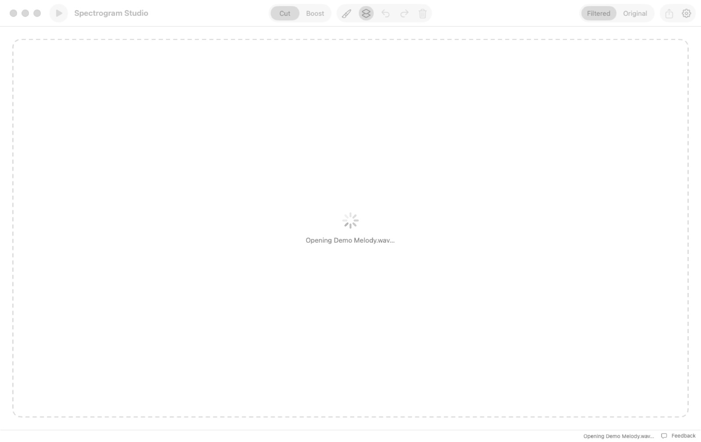
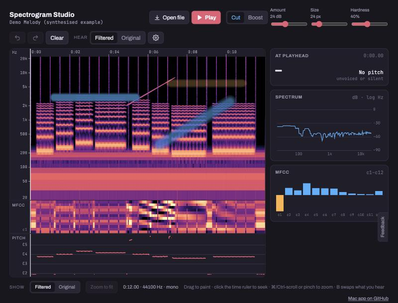
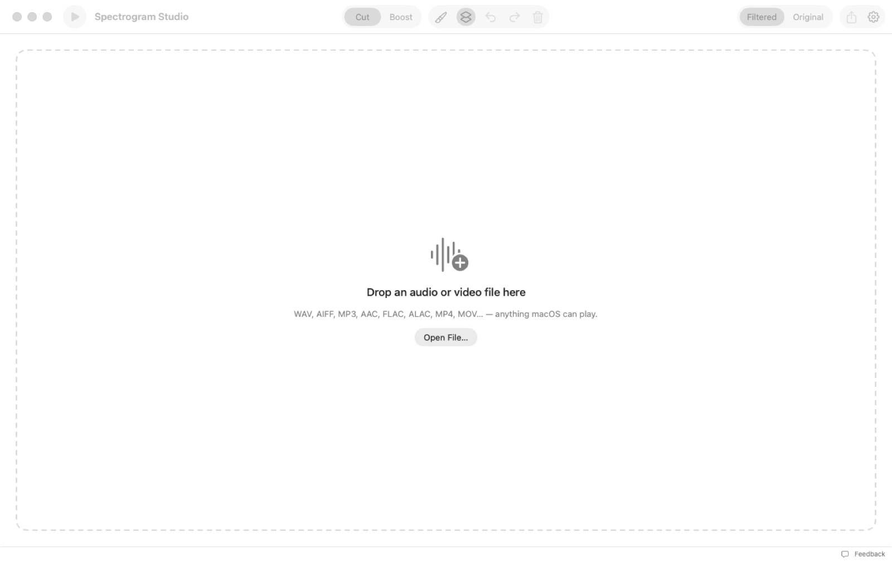
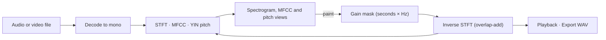

# Spectrogram Studio

A Mac app (and a website) where you drop in any audio or video file, see its STFT spectrogram, MFCCs and pitch track, and paint filters straight onto the spectrogram to hear the result immediately.

**Website:** [amalmehta.github.io/SpectrogramStudio](https://amalmehta.github.io/SpectrogramStudio/)

| Before painting | The website | Empty window |
|---|---|---|
|  |  |  |

**Links:** [Website](https://amalmehta.github.io/SpectrogramStudio/) · [Setup and use](docs/INSTRUCTIONS.md) · [System design](docs/SYSTEM-DESIGN.md) · [File structure](docs/FILE-STRUCTURE.md) · [Original brief](Spectrogram%20Studio.md)
