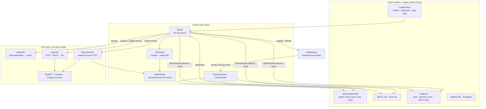

# System Design

Spectrogram Studio is a single-window SwiftUI + AppKit app for macOS 14+. It decodes one file at a time, analyses it on a shared time–frequency grid, lets you paint a gain mask onto that grid, and resynthesises the audio through the mask so you hear the change immediately. The website (`web/index.html`) is a JavaScript port of the same pipeline.

## Architecture

## Components

| Component | Job |
|---|---|
| `AudioFile` | Opens anything AVFoundation can (audio files, and the first audio track of video files) with `AVAssetReader`, asking it to mix down to mono 32-bit float at the file's own sample rate. Also writes WAV for export. |
| `STFTGrid` | The one grid every view and the mask share. Frame *t* is centred on sample *t·hop*; hop = FFT size / 4. Converts between seconds, frames, Hz and bins, and works out which samples a range of frames covers (and vice versa). |
| `RealFFT` | vDSP real FFT that returns a plain DFT (vDSP's ×2 packing undone) so `inverse(forward(x)) == x`. One per thread. |
| `Analyzer` | For each frame: windowed FFT → power → level in dB (quantised to a byte over −120…+24 dB) → mel filterbank → log → DCT (MFCCs); plus a YIN pitch estimate centred on the same sample. Chunks of 512 frames run in parallel with `DispatchQueue.concurrentPerform`. `update` recomputes just a frame range. |
| `PitchTracker` | YIN: the difference function from an FFT cross-correlation and running energy sums, cumulative-mean normalisation, absolute threshold, parabolic interpolation. Silent frames (< −55 dBFS) are unvoiced. |
| `MFCC` | Triangular mel filterbank (20 Hz to Nyquist), log energies, orthonormal DCT-II. |
| `FilterStroke` / `FilterMask` | A stroke is a list of brush stamps in **seconds and Hz**, plus gain, time radius, frequency radius (in the units of the axis it was painted on) and hardness. `FilterMask` holds the strokes and an undo/redo history of snapshots; clearing is an undoable edit. |
| `MaskRaster` | The strokes rasterised onto the current grid as Int8 half-dB steps (−64…+24 dB), plus the set of frames that have any paint. Within a stroke, overlapping stamps take the maximum weight; separate strokes add in dB. |
| `Resynthesizer` | Weighted overlap-add: for each frame, window → FFT → multiply by the mask's linear gains → inverse FFT → window → add, then divide by Σw². Frames with no paint skip the FFT. Works on any frame range and returns the samples it changed. |
| `Studio` | The document and controller: loading, the analyses (original and filtered), the mask, rendering, playback state, the visible time window shared by all timeline views, and export. |
| `AudioPlayer` | One `AVAudioSourceNode` that reads either the original or the filtered buffer under an unfair lock. Because both buffers stay loaded, Hear: Original/Filtered and swapping in a new render happen without stopping playback. |
| `SpectrogramView` | AppKit `NSView`: draws the cached spectrogram bitmap, the mask overlay, axes, ruler, playhead and brush; turns drags into strokes; handles seeking, scroll and pinch. |
| `TimelineRows`, `InspectorView` | MFCC heatmap and pitch track under the spectrogram (same gutter width so the time axes line up); the inspector's charts are Swift Charts. |

## Main flows

**Open a file.** `Studio.open` → `AudioFile.load` (async) → `Analyzer.analyze` on a background task → `install`: player loaded, empty mask and raster, filtered = original, view = whole file.

**Paint a stroke.** Mouse-down/drag collects points (gaps filled every 20% of the brush size). Mouse-up converts them to stamps in seconds and Hz → `Studio.addStroke` → the stroke is added to the mask and rasterised (returning the frames it touched) → `requestRender(frames)`:
1. In the background, the resynthesiser rewrites only the samples those frames cover.
2. Back on the main actor the new buffer is swapped into the player. If you're listening to "Filtered", you hear the change at once, mid-playback.
3. The filtered analysis is recomputed for the touched frames plus a margin of half a pitch window, then the views redraw.

A newer edit cancels an in-flight render and merges its frame range with the pending one, so rapid strokes never leave a stale region.

**Undo / redo / clear.** The history returns the strokes that changed. The raster is rebuilt from the remaining strokes, and only the frames those changed strokes cover are re-rendered.

**Change analysis settings.** New FFT size, window, MFCC or pitch settings re-analyse the original and rebuild the raster on the new grid from the same strokes. Strokes are stored in physical units, so the painting keeps its shape.

**Playback.** The render callback copies from the chosen buffer and advances a position counter. A 30 Hz timer publishes the position to `PlayheadClock`, which only the playhead overlays and the inspector observe, so the spectrogram bitmap isn't rebuilt while playing. When zoomed in, the view pages along with the playhead.

## Where data lives

| Data | Where |
|---|---|
| Decoded samples (original, filtered) | Memory only (`Studio`, and a copy in `AudioPlayer`) |
| Analyses | Memory: 1 byte per frame×bin for levels, plus MFCC and pitch arrays |
| Painted filters | Memory only. Nothing is saved between launches. Export writes the filtered audio. |
| Preferences | `UserDefaults` (keys in `Prefs`) |
| Feedback | `~/Library/Application Support/Spectrogram Studio/Feedback.jsonl`. Nothing is sent unless you choose "Open as GitHub Issue". |
| Website preferences | The browser's `localStorage`, per viewer, best effort |

## Key decisions and trade-offs

- **Re-render on stroke, not real-time masking.** Each stroke resynthesises only the frames it touches, off the main thread, then swaps the buffer into a running player. This is exact, easy to test (the unity-mask test proves perfect reconstruction), and in practice instant. The trade-off: you hear a stroke when you release the mouse, not while you're still dragging.
- **Strokes in seconds and Hz, raster per grid.** Strokes survive zoom, axis and FFT-size changes. The raster is a cache that can always be rebuilt from them.
- **Int8 half-dB mask.** One byte per cell keeps a 3-minute file's mask around 16 MB, with 0.5 dB steps, which is below what you can hear.
- **Byte-quantised levels.** Storing the spectrogram as bytes (0.56 dB steps) instead of floats quarters memory and makes max-pooling and colouring a table lookup.
- **Max-pooling when zoomed out.** Each pixel shows the loudest frame and bin it covers, so short transients don't vanish on long files.
- **Mono.** Analysis, painting and export are mono (the reader mixes channels down). This keeps one mask and one set of views. Stereo is a known limit.
- **Hop fixed at a quarter of the FFT.** 75% overlap gives clean WOLA reconstruction for Hann, Hamming and Blackman, and fine time resolution for painting.
- **AppKit for the spectrogram, Swift Charts for charts.** Painting, scroll-wheel zoom and a large bitmap redrawn on resize are simpler and faster in an `NSView`. The pitch track and the inspector use Swift Charts, with axes hidden on the pitch row so it lines up exactly with the spectrogram's gutter.
- **Website as a port, not a shared engine.** The page reimplements the DSP in plain JavaScript (radix-2 FFT, the same YIN, MFCC, mask and WOLA) so it has no build step and runs as one self-contained page. Playback restarts the buffer source when a render lands (a tiny gap) instead of running a worklet.

## Testing

`xcodebuild … test` runs 22 XCTest cases:

- **DSP:** FFT round trip and scaling; perfect reconstruction with a painted but net-0 dB mask for every window; a −40 dB cut at 3 kHz removes about 40 dB there and leaves 440 Hz untouched; partial re-render equals a full re-render; partial analysis update equals a full re-analysis; spectrogram peak and 0 dBFS calibration; YIN on sines (82–880 Hz), a tone with a weak fundamental, and silence; MFCC c0.
- **Mask:** full gain at a stamp's centre and a soft edge; overlapping stamps don't stack; strokes add and clamp at −64 dB; undo, redo and undoable clear.
- **Files:** WAV round trip through the loader; stereo AAC (.m4a) mixed to mono and tracked at 440 Hz; feedback appended as JSON lines.
- **Interaction:** synthesised mouse events on `SpectrogramNSView` produce a stroke at the right time, frequency and radius; a click on the ruler seeks instead of painting; the player advances, swaps buffers mid-play, pauses and seeks.

Checked by hand: the Release app opening the synthesised MP4 (audio from video) and WAV, demo strokes rendering, and the screenshots in `docs/images/`. The website was checked by loading it in a browser (renders, analyses, paints the demo filters, no console errors).

## Known limits

- Mono only; stereo files are mixed down.
- Painting is heard on mouse-up, not during the drag.
- Painted filters aren't saved between launches (export the audio, or keep the app open).
- Memory grows with length: roughly 5–6 MB per minute for analyses plus the mask once you paint. Very long files (an hour or more) will be slow to analyse and heavy on memory.
- Boosts are capped at +24 dB and cuts at −64 dB. Big boosts can clip. The status bar warns, and export can normalise.
- The brush has a fixed spectral shape (an ellipse with a soft edge); there's no eraser apart from undo or painting the opposite gain.
- Website: decoding depends on the browser (MP4/MOV audio usually works in Chrome and Safari). Long files analyse on the main thread in chunks, so they take a few seconds. Export is a `.zip` containing the WAV.
